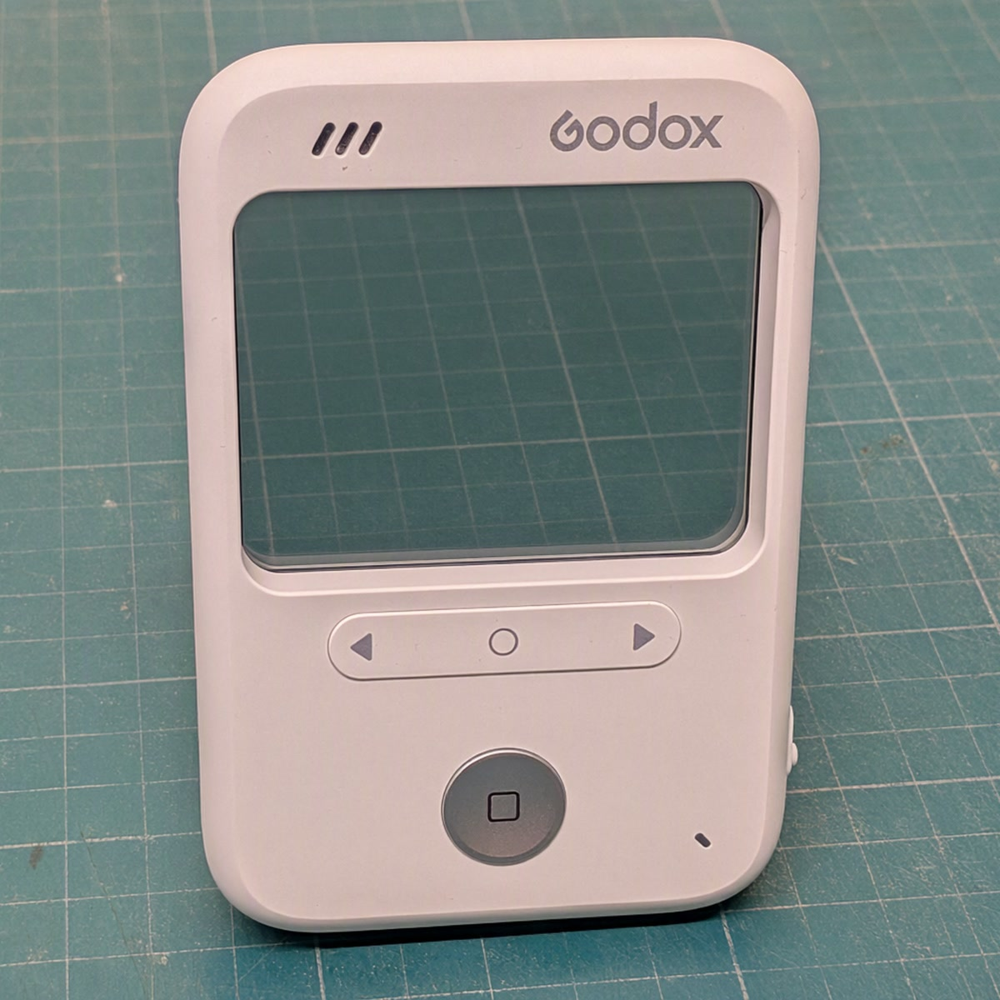

# godox-c100-mods

Patches for the firmware of the Godox C100 card camera (V1.1.6). The code that runs at boot lives
in the 5.6 KB of RAM the stock firmware leaves unused; the features are stored in unused space
in the update file and loaded from the camera's flash into 64 KB taken from the heap. The rest is
a few dozen bytes changed in place. The build starts from Godox's own update file.

Unofficial. A bad flash can brick the camera; read [Recovery](#recovery) first.

## What it does

Tested on a C100 with the earlier build of this patch for firmware V1.1.3. The V1.1.6 build is
not yet tested on the camera.

- USB webcam, MJPEG 1920x1080 from the full sensor, ~27 fps.
- USB mode per switch position: Photo = USB drive, Video and Metering = webcam.
- Display, LED and sounds off from a settings file on the card.
- Long press on the middle button toggles the display and LED.
- `LOG.TXT` on the card with the firmware's own debug output, when switched on.
- `CMD.TXT` on the card, run when the camera finds it.
- No auto power-off while on USB power.

Limits:

- After the camera has been a USB drive (on a PC or a charger), power-cycle it before using the
  webcam.
- No audio over USB.

## Download

The [Releases](../../releases) page has a ready `GP_CARDVR_UPGRADE.BIN` and its `SHA256SUMS`;
skip to [Flash](#flash). Or build it:

## Build

Needs the stock firmware V1.1.6
([Godox_C100_V1.1.6.zip](https://www.godox.com/Downloads/Godox_C100_V1.1.6.zip), linked from the
C100 product page on godox.com; sha256 `3fc9b15c…`), `arm-none-eabi-gcc` and
[uv](https://docs.astral.sh/uv/). The update file is `c100_v1.1.6_20260929/GP_CARDVR_UPGRADE.BIN`
in the zip.

    ./build.sh path/to/GP_CARDVR_UPGRADE.BIN

Output: `build/GP_CARDVR_UPGRADE.BIN`. The script refuses anything but the stock V1.1.6 file
(sha256 `411a553f…`). With arm-none-eabi-gcc 14.2.1 the output's sha256 is
`03023f67a448eb3ff6890e006c6a352727d509e806816cd6d5e98b8a74dc9b58`. This image is not yet
tested on the camera; other compiler versions give other bytes.

Emulator tests: `uv run --group test python tests/test_v5.py build/GP_CARDVR_UPGRADE.BIN obj/v5.sym`

`./release.sh STOCK.BIN` builds, runs the tests and stages the release files in `dist/`.

## Flash

1. Charge the battery.
2. Copy `build/GP_CARDVR_UPGRADE.BIN` to the root of the microSD card.
3. Card in the camera, no USB cable, switch to Photo. The LED blinks for 10-15 s, the camera
   deletes the file and restarts by itself. The clock resets. Only the first card mount after
   power-on can flash: if nothing happens, switch off and on again with the card in.

## Recovery

Flash the stock V1.1.6 `GP_CARDVR_UPGRADE.BIN` the same way. The card updater is part of the
firmware's app and runs on the first card mount after power-on. If the patch's features fail to
load, the camera runs without them (webcam on USB, no auto power-off on USB power, no power-on
chime), the updater works as usual and `LOG.TXT` gets a line `ovl err N`; that path is checked in
the emulator, not on a camera. Details in `docs/firmware.md` and `docs/hooks.md`.

## C100.TXT

Optional, in the card root, read at every card mount. The defaults, commented out:

    # Godox C100 settings. Uncomment a line to change it.

    # LCD on or off. A long press on the middle button toggles display and LED.
    #display=on

    # Status LED.
    #led=on

    # Key, shutter and power-on sounds.
    #sound=on

    # Write LOG.TXT: the patch's lines and the firmware's debug output.
    #log=off

    # USB per switch position: drive or webcam. Only the defaults below are tested.
    #usb_photo=drive
    #usb_video=webcam
    #usb_meter=webcam

    # Pin level that means LED off, GPIO 43 and 95.
    #led_off43=0
    #led_off95=0

## CMD.TXT

Commands, one per line, in the card root. Checked about every 3 s while the camera has the card
(so soon after power-on, a card insert or a USB-drive eject), deleted, then run; results go to
`LOG.TXT` when `log=on`. A file that cannot be deleted is not run, and nothing runs while a
`GP_CARDVR_UPGRADE.BIN` is on the card.

    display on|off      also: led, sound
    set KEY=VALUE       a C100.TXT line, applied now
    reboot              flush the log and restart, unless recording or capturing; with a cable
                        in, USB comes back by itself

## LOG.TXT

Only with `log=on` in `C100.TXT`. Appended about every 2 s while the camera has the card. Blocks
start with `== <ms since boot> <day>d HH:MM:SS`. Lines tagged `[v5]` come from the patch, the rest
is the firmware's own output. Log rotation is not supported.

## USB

The camera enumerates only when the cable goes into a camera that is already on.

- Drive (`1b3f:8301`): buttons and the switch do nothing while a PC has it; unplugging powers
  the camera off.
- Webcam (`1b3f:2002`), for example:

      ustreamer --device=/dev/v4l/by-id/usb-GENERAL_GENERAL_-_UVC-video-index0 \
          --format=MJPEG --encoder=HW --resolution=1920x1080 --host=0.0.0.0 --port=8080

  Then open `http://localhost:8080/stream`, or the machine's address from another device.

## Docs

- `docs/hardware.md`: board, screen, LED, buttons, pins
- `docs/firmware.md`: image layout, boot, card updater, recovery limits
- `docs/hooks.md`: how the patch works, the overlay, the hook table, the tests
- `docs/usb.md`: USB modes and the states behind them
- `docs/webcam.md`: 1080p, the left/right freeze, the record-stop power-off, 720p

## Credits

- [mullwar/godox_c100_custom_firmware](https://github.com/mullwar/godox_c100_custom_firmware):
  image format, resource packing, the first sound mods.
- [mombotro/Godox-C100-GHDK](https://github.com/mombotro/Godox-C100-GHDK): firmware map, file
  API and NOR read addresses, the sensor ID.

## License

MIT.
