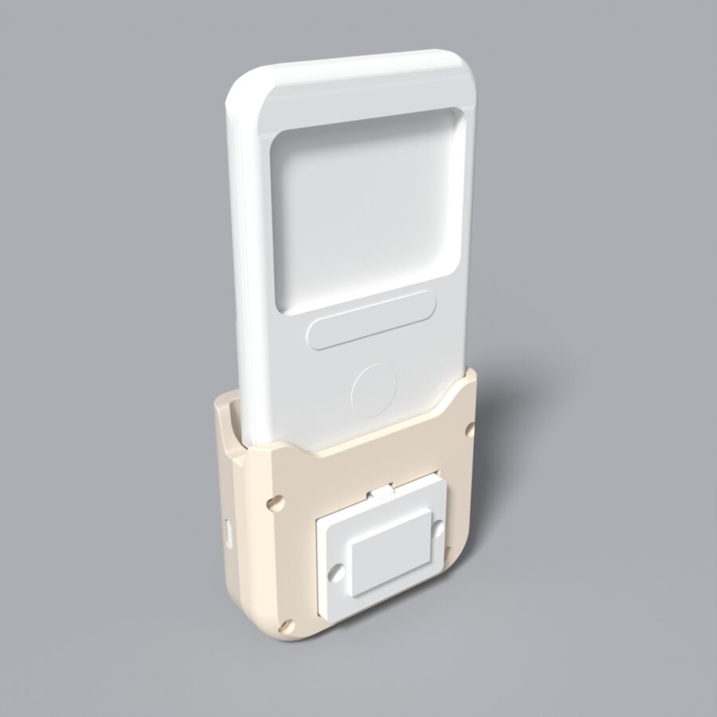

# godox-c100-mods

Mods for the Godox C100 card camera:

- [Firmware](#firmware): patches for its firmware, a USB webcam among them.
- [Case](case/README.md): a printed case that docks it to a Raspberry Pi Zero W, a battery and a
  small OLED.

## Firmware

Patches for the firmware of the Godox C100 card camera.

The patches are added on top of Godox's stock firmware, which is then installed the official way.

This works because:

- the stock firmware is not encrypted, so it can be read and reasoned about trivially
- it has empty space for our compiled code: some space in RAM for what runs at boot, and some
  space of flash for the features
- the updater only checks the file's size and its first four bytes, then flashes it: no
  signature, no checksum

Here are some other projects that also patch the firmware:

- [mullwar/godox_c100_custom_firmware](https://github.com/mullwar/godox_c100_custom_firmware):
  image format, resource packing, sound mods.
- [mombotro/Godox-C100-GHDK](https://github.com/mombotro/Godox-C100-GHDK): firmware map and
  tools.
- [kelleyvanevert/godox_c100](https://github.com/kelleyvanevert/godox_c100): retro dithered
  photos, built in the browser.

Unofficial. A bad flash can brick the camera; read [Recovery](#recovery) first.

### What it does

Tested on a C100 with a V1.1.6 build:

- USB webcam, MJPEG 1920x1080 from the full sensor, ~27 fps.
- USB mode per switch position: Photo = USB drive, Video and Metering = webcam.
- Display, LED and sounds off from a settings file on the card.
- Long press on the middle button toggles the display and LED.
- `LOG.TXT` on the card with the firmware's own debug output, when switched on.
- `CMD.TXT` on the card, run when the camera finds it.
- No auto power-off while on USB power.

Built, not yet tested on the camera:

- Webcam frame sizes 1280x720, 640x360, 320x180, 256x144 and 128x72, all from the full sensor.
- `webcam [MIN]` in `CMD.TXT`: one boot as the webcam whatever the switch.
- `drive` in `CMD.TXT`: one boot as the USB drive whatever the switch.
- Commands from the PC while the camera is the webcam, also while it streams
  (`firmware/tools/c100cmd.py`).

Limits:

- After the camera has been a USB drive (on a PC or a charger), power-cycle it before using the webcam.
- No audio over USB.

### Download

The [Releases](../../releases) page has a ready `GP_CARDVR_UPGRADE.BIN` and its `SHA256SUMS`;
skip to [Flash](#flash). Or build it:

### Build

Needs the stock firmware V1.1.6
([Godox_C100_V1.1.6.zip](https://www.godox.com/Downloads/Godox_C100_V1.1.6.zip), linked from the
C100 product page on godox.com; sha256 `3fc9b15c…`), `arm-none-eabi-gcc` and
[uv](https://docs.astral.sh/uv/). The update file is `c100_v1.1.6_20260929/GP_CARDVR_UPGRADE.BIN`
in the zip.

    firmware/build.sh path/to/GP_CARDVR_UPGRADE.BIN

Output: `firmware/build/GP_CARDVR_UPGRADE.BIN`.

Emulator tests, in `firmware/`: `uv run --group test python tests/test_v5.py build/GP_CARDVR_UPGRADE.BIN obj/v5.sym`

`firmware/release.sh STOCK.BIN` builds, runs the tests and stages the release files in `firmware/dist/`.

### Flash

1. Charge the battery.
2. Copy `firmware/build/GP_CARDVR_UPGRADE.BIN` to the root of the microSD card.
3. Card in the camera, no USB cable, switch to Photo. The LED blinks for 10-15 s, the camera
   deletes the file and restarts by itself. The clock resets. Only the first card mount after
   power-on can flash: if nothing happens, switch off and on again with the card in.

### Recovery

Flash the stock V1.1.6 `GP_CARDVR_UPGRADE.BIN` the same way. The card updater is part of the
firmware's app and runs on the first card mount after power-on. Details in `firmware/docs/firmware.md` and `firmware/docs/hooks.md`.

### C100.TXT

Optional, in the card root, read at every card mount. The defaults, commented out:

    # Godox C100 settings. Uncomment a line to change it.

    # LCD on or off. A long press on the middle button toggles display and LED.
    #display=on

    # Status LED.
    #led=on

    # Key, shutter and power-on sounds.
    #sound=on

    # Write LOG.TXT: the patch's lines and the firmware's debug output.
    #log=off

    # USB per switch position: drive or webcam. Only the defaults below are tested.
    #usb_photo=drive
    #usb_video=webcam
    #usb_meter=webcam

    # Pin level that means LED off, GPIO 43 and 95.
    #led_off43=0
    #led_off95=0

### CMD.TXT

Commands, one per line, in the card root. Checked about every 3 s while the camera has the card
(so soon after power-on, a card insert or a USB-drive eject), deleted, then run; results go to
`LOG.TXT` when `log=on`. A file that cannot be deleted is not run, and nothing runs while a
`GP_CARDVR_UPGRADE.BIN` is on the card.

    display on|off      also: led, sound
    set KEY=VALUE       a C100.TXT line, applied now
    reboot              flush the log and restart, unless recording or capturing; with a cable
                        in, USB comes back by itself. With the webcam up, not yet tested on the
                        camera
    webcam [MIN]        restart as the webcam, whatever the switch, for that boot only; with
                        MIN (1 to 1440), restart again MIN minutes later and follow the switch
                        (firmware/docs/usb.md). Not yet tested on the camera
    drive               restart as the USB drive, whatever the switch, for that boot only
                        (firmware/docs/usb.md). Not yet tested on the camera

### Commands from the PC

While the camera is the webcam, a Linux PC can send it one `CMD.TXT` line at a time, also while
another program streams from it:

    uv run firmware/tools/c100cmd.py display off
    uv run firmware/tools/c100cmd.py drive

The camera runs the line as if it came from `CMD.TXT` and logs it as `xu: <line>`; `drive` turns
the webcam into the USB drive without touching the switch. The tool finds the camera by its USB
ID (`--device /dev/videoN` to pick one) and needs only Python 3.11. Lines up to 32 characters.
The camera takes a line only while it has a card and the patch loaded. The line goes through a
UVC extension unit (firmware/docs/webcam.md). Not yet tested on the camera.

### LOG.TXT

Only with `log=on` in `C100.TXT`. Appended about every 2 s while the camera has the card. Blocks
start with `== <ms since boot> <day>d HH:MM:SS`. Lines tagged `[v5]` come from the patch, the rest
is the firmware's own output. Log rotation is not supported.

### USB

The camera enumerates only when the cable goes into a camera that is already on.

- Drive (`1b3f:8301`): buttons and the switch do nothing while a PC has it; unplugging powers
  the camera off.
- Webcam (`1b3f:2002`), for example:

      ustreamer --device=/dev/v4l/by-id/usb-GENERAL_GENERAL_-_UVC-video-index0 \
          --format=MJPEG --encoder=HW --resolution=1920x1080 --host=0.0.0.0 --port=8080

  Then open `http://localhost:8080/stream`, or the machine's address from another device.
  Frame sizes, all 16:9 from the full sensor: 1920x1080 (the default), 1280x720, 640x360,
  320x180, 256x144, 128x72. Pick one with `--resolution=256x144` in ustreamer, or
  `v4l2-ctl --set-fmt-video=width=256,height=144,pixelformat=MJPG`. Only 1920x1080 is tested on
  the camera so far.

### Docs

- `firmware/docs/hardware.md`: board, screen, LED, buttons, pins
- `firmware/docs/firmware.md`: image layout, boot, card updater, recovery limits
- `firmware/docs/hooks.md`: how the patch works, the overlay, the hook table, the tests
- `firmware/docs/usb.md`: USB modes and the states behind them, one boot as the webcam or the drive
- `firmware/docs/webcam.md`: 1080p, frame sizes, left/right and recording while streaming, the extension
  unit

## Case

A two-part printed case: the camera sits in a cup on top, a USB-C plug in its floor; inside, a
Raspberry Pi Zero W, a 1200 mAh cell with its charger, and on the back a 128x64 1-bit OLED. The
Pi runs [ghee](https://github.com/holofermes/ghee) to draw on the OLED. Parts, printing and
wiring: [case/README.md](case/README.md). In 3D: https://holofermes.github.io/godox-c100-mods/

## Credits

- [mullwar/godox_c100_custom_firmware](https://github.com/mullwar/godox_c100_custom_firmware):
  image format, resource packing, the first sound mods.
- [mombotro/Godox-C100-GHDK](https://github.com/mombotro/Godox-C100-GHDK): firmware map, file
  API and NOR read addresses, the sensor ID.

## License

MIT.
