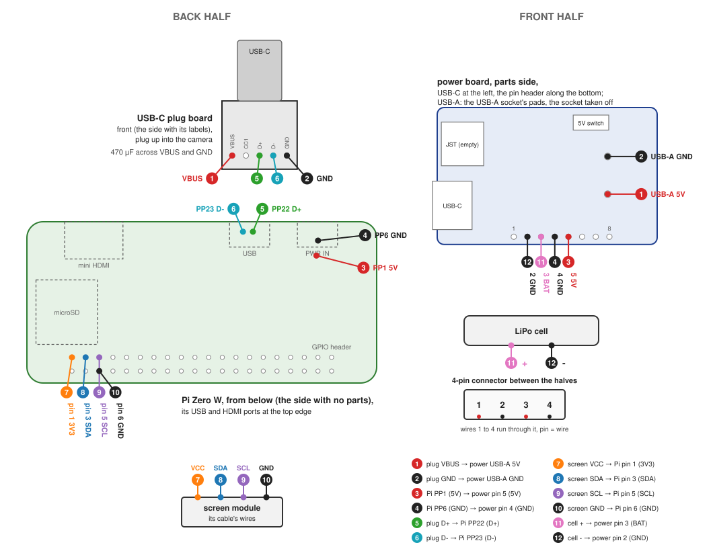
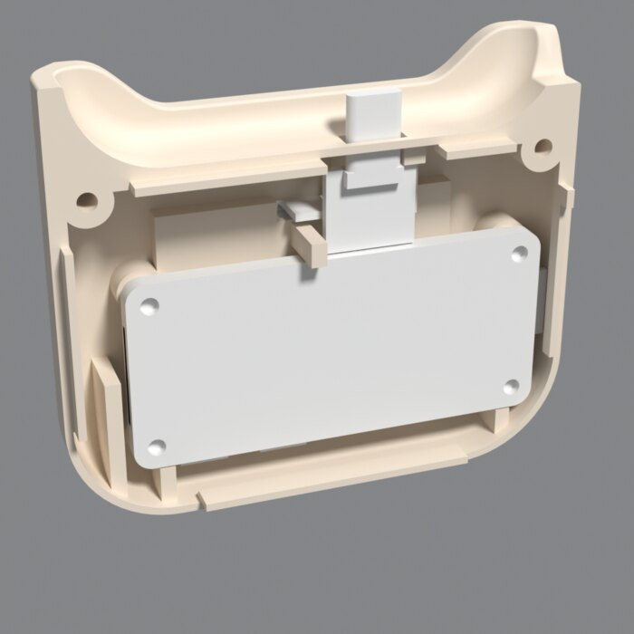
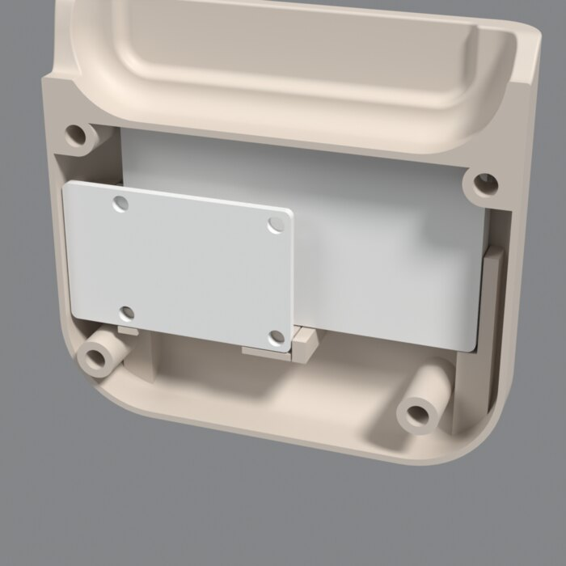

# Case

A printed case in two halves. The C100 sits in a cup on top, with a USB-C plug in the cup's floor
going into its port. Inside: a Raspberry Pi Zero W, a 1200 mAh cell and its charger, and a 128x64
1-bit OLED on the back. The camera runs as a USB webcam with the [firmware](../README.md#firmware),
plugged into the Pi; the Pi runs [ghee](https://github.com/holofermes/ghee), which drives the OLED.

## Parts

| part | qty |
|---|---|
| Raspberry Pi Zero W | 1 |
| [Seeed Lipo Rider Plus](https://www.digikey.com/en/products/detail/seeed-technology-co-ltd/106990290/10451861) | 1 |
| [Adafruit USB Type C Plug Breakout #5978](https://www.adafruit.com/product/5978) | 1 |
| [Argon ONE V5 OLED module](https://www.waveshare.com/argon-one-v5-oled-module.htm) | 1 |
| [Adafruit LiPo 3.7 V 1200 mAh #258](https://www.adafruit.com/product/258) | 1 |
| 470 µF 6.3 V capacitor | 1 |
| 4-pin connector pair, 1.25 mm pitch, with wires | 1 |
| M2.5 heat-set insert, 3.4 mm | 7 |
| M2.5 x 12 socket head screw | 4 |
| M2.5 x 6 socket head screw | 3 |

## Print

Run `./build.sh case` to write out STL and 3MF.

## Assembly

- Inserts: 4 in the front half's bosses, from their open ends; 1 in the plug board's block; 2 in
  the screen's bosses, from the screen's recess.
- The power board's USB-A socket must come off, use some pliers to cut the feet and pry it away, peel off the leads
- Wire each half, plug the halves' connector together, close with the four M2.5 x 12 from the
  back.

## Wiring

Both ends of a wire carry the same number; 1 to 4 run between the halves through the connector.

| wire | from | to |
|---|---|---|
| 1 | USB-C plug board: VBUS | power board: USB-A pad 5V, through the connector |
| 2 | USB-C plug board: GND | power board: USB-A pad GND, through the connector |
| 3 | Pi: PP1 (5V) | power board: header pin 5 (5V), through the connector |
| 4 | Pi: PP6 (GND) | power board: header pin 4 (GND), through the connector |
| 5 | USB-C plug board: D+ | Pi: PP22 (D+) |
| 6 | USB-C plug board: D- | Pi: PP23 (D-) |
| 7 | screen: VCC | Pi: GPIO pin 1 (3V3) |
| 8 | screen: SDA | Pi: GPIO pin 3 (SDA) |
| 9 | screen: SCL | Pi: GPIO pin 5 (SCL) |
| 10 | screen: GND | Pi: GPIO pin 6 (GND) |
| 11 | cell: + | power board: header pin 3 (BAT) |
| 12 | cell: - | power board: header pin 2 (GND) |

Where the boards sit, back half and front half:

 

## Build

Needs [uv](https://docs.astral.sh/uv/).

    ./build.sh case                  # model, run the checks, write out/case-NN/
    ./build.sh case --keys           # every setting and its default
    ./build.sh case --set KEY=VALUE  # change one
    ./render.sh out/case-NN          # renders with Blender; RENDER_HOST=user@host renders there
    uv run python wiring.py          # images/wiring.svg
    uv run tools/slice.py --help     # slice with OrcaSlicer's command line

`out/case-NN/` holds the STL and 3MF of each half, `assembly.glb` and `assembly.step`,
`print.md` (bodies, hardware, parts), `checks.json`, `sizes.json` (sizes and notes),
`config.json` (the settings) and `render.json` (what the viewer and the renders read).

## Changing it

- `designs/case.py` is the design: its `Config` holds the settings, `build()` places the parts
  and models both halves. `lib/` holds the shared pieces: parts, geometry, the camera, checks,
  export, renders.
- Frame: X across the camera, Y from its back to its front, Z up, Z 0 at the camera's bottom.
  Each half prints on its outer face, so a holder grows from that face along Y; faces past 45
  degrees need support.
- Sizes come from `parts.json`, each with its source; `estimate` marks the ones not measured. A
  size or feature that is missing stops the build.
- After a change: all checks pass (`./build.sh case` exits 0) and the renders look right. A change
  meant to leave the halves alone leaves `back.stl` and `front.stl` byte-identical.
- After a change to the halves: copy `out/case-NN/assembly.glb` and `render.json` to
  `viewer/case.glb` and `viewer/case.json` and replace the changed renders in `images/`. After a
  change to the wiring: `uv run python wiring.py` and the table above.
- Lint: `uv run ruff format . && uv run ruff check .`
