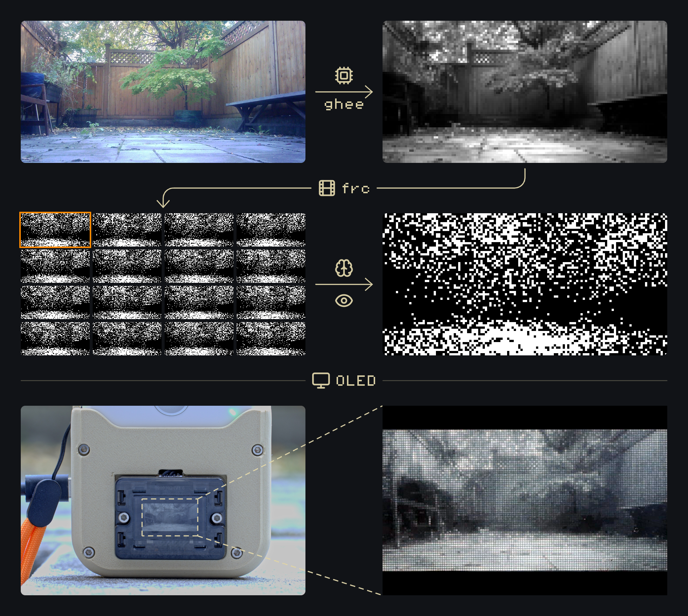
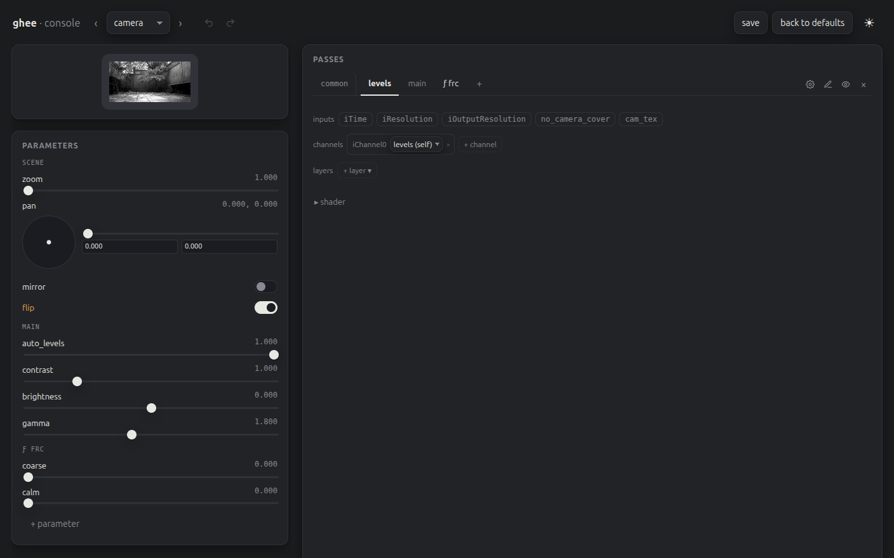

# Display

A [ghee](https://github.com/holofermes/ghee) scene drives the OLED, and shows the camera feed on a
1-bit panel, using an [frc](https://en.wikipedia.org/wiki/Frame_rate_control) filter.

## The console

You can tweak the picture live by using the console. To open it, tunnel to the Pi with
`ssh -L 8090:localhost:8090 pi@PI`, then go to http://localhost:8090/.

